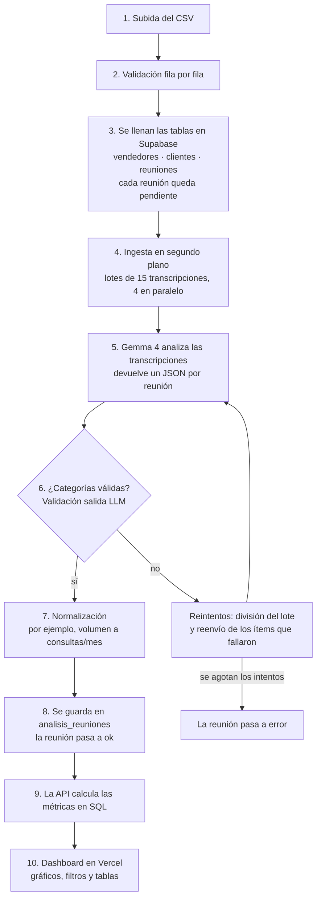
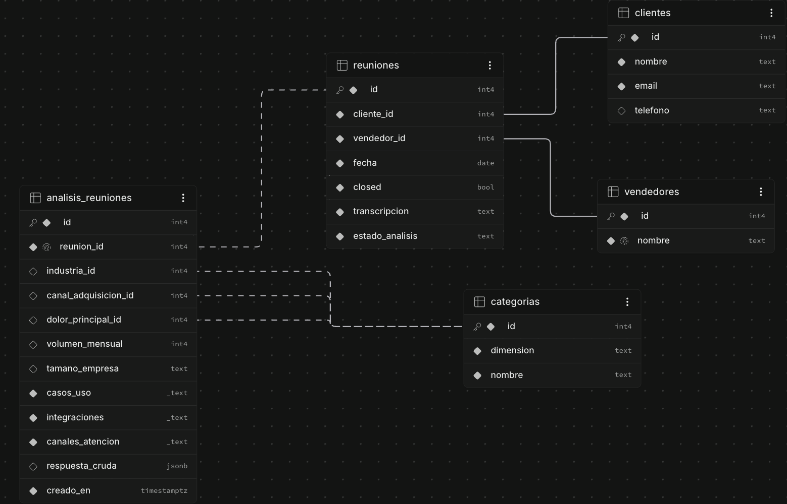

# Vambe Insights

Categorización automática de reuniones de venta con un LLM (Gemma 4) y un dashboard para que el equipo comercial de Vambe responda tres preguntas:

1. **¿Qué leads cierran?** Tasa de cierre por industria, canal de adquisición, dolor, tamaño y volumen de consultas.
2. **¿Cómo rinde cada vendedor?** Ranking y matriz vendedor × industria, útil para asignar cada lead a quien mejor lo cierra.
3. **¿Qué pide el mercado?** Casos de uso, integraciones y canales que piden los clientes, y si pedirlos se asocia a cerrar más o menos.

| | |
|---|---|
| **App** | https://prueba-tecnica-v.vercel.app/ |
| **API (Swagger)** | https://vambe-api.onrender.com/docs |
| **Estado de la API** | https://vambe-api.onrender.com/health |
| **Datos cargados** | Las primeras 2.000 filas del CSV original, ya analizadas |

> La API corre en el plan gratuito de Render: si estuvo 15 min sin uso, el primer request tarda ~50 s en despertarla. El dashboard lo avisa y se llena solo.

## Índice

- [Cómo correrlo en local](#cómo-correrlo-en-local)
- [Arquitectura](#arquitectura)
   - [Stack](#stack)
   - [Modelo de datos](#modelo-de-datos)
- [Decisiones clave](#decisiones-clave)
   - [1. Taxonomía, pensada para decisiones de venta](#1-taxonomía-pensada-para-decisiones-de-venta)
   - [2. El LLM extrae, el código calcula](#2-el-llm-extrae-el-código-calcula)
   - [3. Salida del LLM robusta](#3-salida-del-llm-robusta)
   - [4. Dashboard](#4-dashboard)
   - [5. Probar el modelo](#5-probar-el-modelo)

---

## Cómo correrlo en local

**Requisitos:** Node 24, pnpm 12 (`corepack enable` toma la versión fijada en `package.json`), una base Postgres (Supabase) y una API key gratuita de Google AI Studio.

```bash
pnpm install

# 1. Base de datos: aplicar la migración en el SQL Editor de Supabase
#    supabase/migrations/0001_init.sql

# 2. Variables de entorno
cp apps/api/.env.example apps/api/.env   # DATABASE_URL, GEMINI_API_KEY, GEMINI_MODEL
cp apps/web/.env.example apps/web/.env   # NEXT_PUBLIC_API_URL (por defecto http://localhost:3001)

# 3. Taxonomía + carga y análisis de un segmento del CSV
pnpm --filter api seed
pnpm --filter api ingesta --filas 200   # carga las primeras 200 filas de data/ y las analiza

# 4. API (http://localhost:3001) y web (http://localhost:3000)
pnpm dev
```

| Variable | Dónde | Descripción |
|---|---|---|
| `DATABASE_URL` | api | Connection string del *session pooler* de Supabase |
| `GEMINI_API_KEY` / `GEMINI_MODEL` | api | Key de AI Studio y modelo (`gemma-4-26b-a4b-it`) |
| `CORS_ORIGIN` | api | Orígenes permitidos, separados por coma |
| `LLM_RPM`, `INGESTA_BATCH_SIZE`, `INGESTA_CONCURRENCIA` | api | Ritmo de la ingesta (opcionales; por defecto 4, 15 y 4) |
| `NEXT_PUBLIC_API_URL` | web | URL de la API |

**Opciones de la ingesta:** `--filas N` (cuántas filas del CSV cargar, solo si la base está vacía), `--limit N` (cuántas analizar), `--batch`, `--concurrencia`, `--csv ruta`. Es **reanudable**: si se corta, se vuelve a correr el mismo comando y sigue con lo pendiente o con error.

**Tests:** `pnpm test` (124 unitarios: shared + api), `pnpm --filter api test:e2e` (7 e2e contra la base real, solo lecturas y con el LLM simulado), `pnpm lint`, `pnpm build`.

---

## Arquitectura



### Stack

| Tecnología | Por qué |
|---|---|
| **TypeScript + monorepo (pnpm + Turborepo)** | Front y back comparten los mismos tipos y schemas desde `packages/shared`; Turborepo compila shared antes que las apps. |
| **NestJS** | Estructura modular por dominio e inyección de dependencias: cambiar de LLM o testear con uno falso es reemplazar un provider. Trae Swagger. |
| **Drizzle ORM + postgres-js** | SQL tipado y muy cercano al SQL real, ideal para las métricas (agregaciones, `filter`, `unnest`). Liviano y sin generar código. |
| **PostgreSQL en Supabase** | Datos relacionales (FK a la taxonomía) y arrays con índices GIN para las dimensiones de varios valores. Gestionado y gratis; solo la API accede a la base. |
| **Gemma 4 (Gemini API)** | Gratis y el sugerido. Soporta modo JSON. |
| **Next.js 16 (App Router)** | Estándar de React, una ruta por página y deploy directo en Vercel. |
| **shadcn/ui + Tailwind** | Componentes accesibles (Radix) que viven en el repo. |
| **Recharts** | Librería de gráficos. |
| **Render (API) + Vercel (web)** | Simpleza y eficiencia. |
```
apps/api         NestJS: ingesta, análisis con LLM, métricas, cargas, Swagger
  src/llm          LLMProvider (interfaz) + GeminiProvider + rate limiter
  src/analisis     prompt, parseo y validación, analizador (reintentos y división de lotes)
  src/ingesta      lectura del CSV + ingesta reanudable por lotes
  src/cargas       subida de CSV desde la UI y progreso
  src/metricas     agregaciones en SQL (cierre, vendedores, demanda, volumen, tendencia)
  src/reuniones    listado paginado con filtros y detalle
  src/datos        borrado de datos para empezar desde cero
apps/web         Next.js 16 + shadcn/ui + Recharts
packages/shared  Contrato común: taxonomía (enums Zod), labels, schema de salida del LLM,
                 filtros y tipos de respuesta de la API
supabase/        migración SQL
data/            CSV original
```

### Modelo de datos



`vendedores`, `clientes`, `reuniones` (con `estado_analisis`), `categorias` (la taxonomía, con FK desde el análisis) y `analisis_reuniones` (una fila por reunión, con arrays indexados para casos de uso, integraciones y canales).

---

## Decisiones clave

### 1. Taxonomía, pensada para decisiones de venta
| Dimensión | Valores | Para qué sirve |
|---|---|---|
| Industria | salud, retail, educación, …, otro | Priorizar segmentos que cierran más |
| Canal de adquisición | recomendación, LinkedIn, evento, … | Saber dónde invertir en marketing |
| Dolor principal | equipo saturado, consultas repetitivas, … | Adaptar el pitch al problema |
| Tamaño de empresa | micro, pequeña, mediana, grande | Calificar el lead |
| Volumen mensual | número normalizado | Calificar el lead y estimar valor |
| Casos de uso, integraciones, canales | listas de varios valores | Roadmap de producto y argumentos de venta |


### 2. El LLM extrae, el código calcula
- **Volumen:** Gemma devuelve `{min, max, periodo}` tal como lo dijo el cliente ("entre 800 y 1.500 diarias"). El código lo normaliza a consultas/mes con factores de calendario (día ×365/12, semana ×52/12, año ×1/12). Un LLM puede tener errores en el calculo.
- **Los "peaks" se descartan:** "300 consultas por hora en Black Friday" no es el volumen habitual.

### 3. Salida del LLM robusta
- **Modo JSON + validación propia.** El modo JSON asegura que la respuesta sea JSON, pero no que la industria exista. Cada ítem se valida contra el schema de `shared`, de forma tolerante con mayúsculas, tildes y plurales ("otros" → "otro").
- **Recuperación escalonada:** reintento si el JSON viene inválido → división del lote en mitades → reenvío solo de los ítems que fallaron. 
- **Reanudable:** cada reunión tiene un estado (`pendiente`/`ok`/`error`). Si el proceso o el servidor se reinician, se retoma lo pendiente.

### 4. Dashboard
- **Los datos se piden desde el navegador** y no desde el servidor de Next. La API en Render puede tardar ~50 s en despertar. El usuario ve "Despertando el servidor…" en vez de un error.
- Cada gráfico abre con **una frase de conclusión** calculada desde los datos ("Cierra más: LinkedIn, 7 pts sobre el promedio").

### 5. Probar el modelo
- **Análisis en vivo** de una transcripción (no se guarda).
- **Subida de CSV** de hasta **1.000 filas** (26 min aprox de análisis con el free tier), con barra de progreso.
- **Empezar desde cero:** borra reuniones, clientes, vendedores y análisis con un `TRUNCATE` de una lista fija de tablas (sin `CASCADE`); la estructura y la taxonomía no se tocan.
